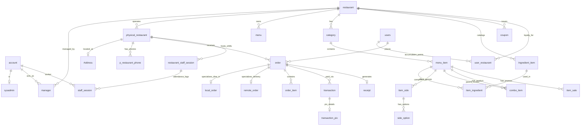

# Pratello Database Schema & Domain Architecture

> **Target Audience:** LLMs, Autonomous Coding Agents, and Developers.  
> **Purpose:** High-density, unambiguous reference for database schema, relational keys, invariants, and business domain logic.

---

## 1. Domain Map & Relational Graph

---

## 2. Table Schemas (28 Entities)

### Group A: Identity, Access & Profiles

| Table | Columns (PK, FK, Constraints) | Invariants & Business Rules |
| :--- | :--- | :--- |
| `account` | `id` (PK, INT/UUID) `email` (UNIQUE, VARCHAR) `password_hash` (TEXT) `phone` (VARCHAR) `created_at` (TIMESTAMP) | Global credentials for sysadmins, managers, and staff. Never stores plain passwords. |
| `sysadmin` | `id` (PK) `account_id` (FK -> `account.id`, UNIQUE) | Superuser with global platform access across all tenants/restaurants. |
| `manager` | `id` (PK) `restaurant_slug` (FK -> `restaurant.slug`) `account_id` (FK -> `account.id`) UNIQUE(`restaurant_slug`, `account_id`) | Scopes an account's management permissions to a specific restaurant tenant. |
| `users` | `cpf` (PK, CHAR(11)) `name` (VARCHAR) `phone` (VARCHAR) `created_at` (TIMESTAMP) | End consumers. Identified by Brazilian CPF for loyalty point tracking and history across orders. |

### Group B: Tenants & Physical Outlets

| Table | Columns (PK, FK, Constraints) | Invariants & Business Rules |
| :--- | :--- | :--- |
| `restaurant` | `slug` (PK, VARCHAR) `name` (VARCHAR) `description` (TEXT) `created_at` (TIMESTAMP) | Top-level tenant. Owner of menus, products, coupons, and global branding. |
| `physical_restaurant`| `id` (PK) `restaurant_slug` (FK -> `restaurant.slug`) `name` (VARCHAR) `address_id` (FK -> `Address.id`) | Physical branch/store of a brand. Processes orders, delivery dispatch, and work shifts. |
| `Address` | `id` (PK) `cep` (CHAR(8)) `street` (VARCHAR) `number` (VARCHAR) `apt` (VARCHAR, NULLABLE) `complement` (VARCHAR, NULLABLE) | Shared postal address entity for branches and delivery destinations. |
| `p_restaurant_phone` | `id` (PK) `branch_id` (FK -> `physical_restaurant.id`) `phone_number` (VARCHAR) `phone_type` (VARCHAR) | Branch contact numbers (e.g. `whatsapp`, `landline`, `customer_service`). |

### Group C: Menu, Catalog & Composition

| Table | Columns (PK, FK, Constraints) | Invariants & Business Rules |
| :--- | :--- | :--- |
| `menu` | `id` (PK) `restaurant_slug` (FK -> `restaurant.slug`, UNIQUE) `name` (VARCHAR) `template_style` (VARCHAR) `accent_color` (CHAR(7)) `typography` (VARCHAR) | UI theme & visual layout settings for the interactive digital menu (QR / web). |
| `category` | `id` (PK) `restaurant_slug` (FK -> `restaurant.slug`) `name` (VARCHAR) `display_order` (INT) | Menu visual grouping (e.g., "Starters", "Beverages", "Burgers"). Sorted by `display_order`. |
| `menu_item` | `id` (PK) `category_id` (FK -> `category.id`) `name` (VARCHAR) `description` (TEXT) `base_price` (DECIMAL(10,2)) `photo_url` (TEXT) `is_combo` (BOOLEAN) `is_available` (BOOLEAN) | Sellable catalog item. If `is_combo = TRUE`, recipes live in `combo_item`. |
| `Ingredient_item` | `id` (PK) `restaurant_slug` (FK -> `restaurant.slug`) `name` (VARCHAR) | Raw materials catalog (e.g., "Onion", "Cheddar", "Bacon"). |
| `item_ingredient` | `item_id` (PK, FK -> `menu_item.id`) `ingredient_id` (PK, FK -> `Ingredient_item.id`) `proportion` (VARCHAR) `is_removable` (BOOLEAN) | Technical spec. Defines whether customers can customize (remove) an ingredient. |
| `item_side` | `id` (PK) `item_id` (FK -> `menu_item.id`) `title` (VARCHAR) `min_options` (INT) `max_options` (INT) | Group of options/addons (e.g. "Meat Doneness" min=1 max=1, "Extra Addons" min=0 max=3). |
| `side_option` | `id` (PK) `side_id` (FK -> `item_side.id`) `name` (VARCHAR) `additional_price` (DECIMAL(10,2)) | Concrete choices inside a side group (e.g. "+R$ 4.00 Bacon"). `additional_price >= 0`. |
| `combo_item` | `combo_id` (PK, FK -> `menu_item.id`) `sub_item_id` (PK, FK -> `menu_item.id`) `quantity` (INT) | Blueprint bundle: defines which products and quantities compose a combo item. |
| `item_sale` | `id` (PK) `item_id` (FK -> `menu_item.id`) `discount_type` ('percent'\|'fixed') `discount_value` (DECIMAL(10,2)) `starts_at` (TIMESTAMP) `ends_at` (TIMESTAMP) | Temporary price discount rules active within the `starts_at` -> `ends_at` window. |

### Group D: Loyalty & Promotions

| Table | Columns (PK, FK, Constraints) | Invariants & Business Rules |
| :--- | :--- | :--- |
| `user_restaurant` | `user_cpf` (PK, FK -> `users.cpf`) `restaurant_slug` (PK, FK -> `restaurant.slug`) `points_balance` (INT) | Tracks customer coins/cashback balance per tenant (`points_balance >= 0`). |
| `coupon` | `id` (PK) `restaurant_slug` (FK -> `restaurant.slug`) `code` (VARCHAR) `discount_type` ('percent'\|'fixed') `discount_value` (DECIMAL(10,2)) `min_order_value` (DECIMAL(10,2)) `expires_at` (TIMESTAMP) `max_uses` (INT) | Tenant coupon validation. `code` must be unique per restaurant tenant. |

### Group E: Orders & Sales (Dine-in vs. Delivery)

| Table | Columns (PK, FK, Constraints) | Invariants & Business Rules |
| :--- | :--- | :--- |
| `order` | `id` (PK) `branch_id` (FK -> `physical_restaurant.id`) `user_cpf` (FK -> `users.cpf`, NULLABLE) `order_type` ('local'\|'remote') `status` ('pending'\|'preparing'\|'ready'\|'delivered'\|'cancelled') `subtotal` (DECIMAL(10,2)) `discount` (DECIMAL(10,2)) `total` (DECIMAL(10,2)) `created_at` (TIMESTAMP) | Root order. `total = (subtotal - discount + freight_fee)`. Subtotal is computed from `order_item`. |
| `local_order` | `order_id` (PK, FK -> `order.id`) `table_number` (INT) `display_order` (INT) | 1-to-1 specialization for dine-in consumption at tables/tabs. |
| `remote_order` | `order_id` (PK, FK -> `order.id`) `address_id` (FK -> `Address.id`) `contact_phone` (VARCHAR) `freight_fee` (DECIMAL(10,2)) | 1-to-1 specialization for delivery orders. Freight fee added to total. |
| `order_item` | `id` (PK) `order_id` (FK -> `order.id`) `item_id` (FK -> `menu_item.id`) `unit_price_frozen` (DECIMAL(10,2)) `quantity` (INT) `notes` (TEXT) `parent_order_item_id` (FK -> `order_item.id`, NULLABLE) | Line items. **`unit_price_frozen` locks the price** at purchase time. Supports hierarchy for combos. |

### Group F: Payments & Digital Receipts

| Table | Columns (PK, FK, Constraints) | Invariants & Business Rules |
| :--- | :--- | :--- |
| `transaction` | `id` (PK) `order_id` (FK -> `order.id`) `amount` (DECIMAL(10,2)) `payment_method` ('credit_card'\|'debit_card'\|'pix'\|'cash') `status` ('pending'\|'paid'\|'failed'\|'refunded') `created_at` (TIMESTAMP) | Financial record of payment attempts. An order may have split or retried transactions. |
| `transaction_pix` | `transaction_id` (PK, FK -> `transaction.id`) `copy_paste_code` (TEXT) `qr_code_base64` (TEXT) `expires_at` (TIMESTAMP) | Specialized PIX payload for real-time Brazilian instant payments. |
| `receipt` | `receipt_code` (PK, VARCHAR) `order_id` (FK -> `order.id`, UNIQUE) `receipt_json` (JSONB/TEXT) `issued_at` (TIMESTAMP) | Immutable serialized snapshot of completed order for legal/accounting records. |

### Group G: Shifts & Staff Operations

| Table | Columns (PK, FK, Constraints) | Invariants & Business Rules |
| :--- | :--- | :--- |
| `restaurant_staff_session` | `id` (PK) `branch_id` (FK -> `physical_restaurant.id`) `shift_code` (VARCHAR) `qr_token` (VARCHAR) `opened_at` (TIMESTAMP) `closed_at` (TIMESTAMP, NULLABLE) | Active operational shift in a branch (e.g. Lunch or Dinner). Provides QR token for clock-in. |
| `staff_session` | `id` (PK) `restaurant_staff_session_id` (FK -> `restaurant_staff_session.id`) `account_id` (FK -> `account.id`) `checked_in_at` (TIMESTAMP) `checked_out_at` (TIMESTAMP, NULLABLE) | Individual employee attendance punch tied to the active branch shift. |

---

## 3. Core Business Invariants for Implementation

1. **Multi-Tenancy Isolation:**
   - Every catalog resource (`menu`, `category`, `menu_item`, `Ingredient_item`, `coupon`) is bound directly or transitively to `restaurant.slug`. Queries MUST filter by tenant.
2. **Order Inheritance:**
   - An `order` MUST have exactly one matching subtype record: either `local_order` (if `order_type = 'local'`) or `remote_order` (if `order_type = 'remote'`).
3. **Price Immutability:**
   - Never query `menu_item.base_price` to compute historic order totals. Always use `order_item.unit_price_frozen`.
4. **Combo Composition:**
   - If `menu_item.is_combo == true`, child units are defined in `combo_item`. In `order_item`, children point to parent via `parent_order_item_id`.
5. **Business Model (Take-Rate):**
   - Platform monetizes via a % fee on `order.total`. Platform earnings = `order.total * commission_rate`.
