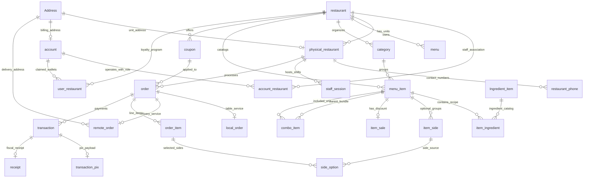

# Pratello Database Schema & Domain Architecture (DBML Aligned)

> **Target Audience:** LLMs, Autonomous Coding Agents, and Developers.  
> **Source of Truth:** DBML Schema Specification.  
> **Key Architectural Principles:**  
> 1. Privacy by Design: Orders (`order`) do not store CPFs or FKs to users/accounts.  
> 2. Decoupled Loyalty: `user_restaurant` tracks coins by `cpf`. Accumulation is anonymous/by CPF; **redemption strictly requires an active `account` (`account_id IS NOT NULL`)**.  
> 3. Enums in uppercase (`ORDER_STATUS`, `TRANSACTION_TYPE`, etc.).

---

## 1. Domain Map & Relational Graph

---

## 2. Enums

- **`card_brand_enum`**: `VISA`, `MASTERCARD`, `ELO`, `AMEX`, `HIPERCARD`, `OTHER`
- **`discount_type_enum`**: `PERCENTAGE`, `FIXED_AMOUNT`
- **`menu_style_enum`**: `CLASSICO`, `EXPERIENCIA`
- **`order_status_enum`**: `PENDING`, `PREPARING`, `READY`, `COMPLETED`, `CANCELLED`
- **`order_type_enum`**: `LOCAL`, `REMOTE`
- **`transaction_status_enum`**: `PENDING`, `COMPLETED`, `EXPIRED`, `FAILED`, `CANCELLED`
- **`transaction_type_enum`**: `PIX`, `CREDIT`, `DEBIT`, `CASH`

---

## 3. Detailed Table Dictionary

### Group A: Identity, Management & Address

| Table | Primary Key | Foreign Keys & References | Key Columns & Notes |
| :--- | :--- | :--- | :--- |
| `account` | `id` (INT, autoincrement) | `address_id` -> `Address.id` (nullable) | `name`, `email` (UNIQUE), `password`, `phone`, `document` (CPF/CNPJ). |
| `account_restaurant` | `(id, restaurant_id)` | `account_id` -> `account.id` `restaurant_id` -> `restaurant.id` | `account_type` (Role: manager, staff, admin), `document`. |
| `Address` | `id` (INT, autoincrement) | Ref by `account`, `physical_restaurant`, `remote_order` | `CEP`, `number` (INT), `apt`, `complementary`. |

### Group B: Tenants, Outlets & Shifts

| Table | Primary Key | Foreign Keys & References | Key Columns & Notes |
| :--- | :--- | :--- | :--- |
| `restaurant` | `id` (INT, autoincrement) | Referenced across catalog & orders | `name_slug` (VARCHAR 500, UNIQUE format), `name`, `brand`, `cnpj`. |
| `physical_restaurant` | `(id, restaurant_id, address_id)` | `restaurant_id` -> `restaurant.id` `address_id` -> `Address.id` | `cnpj` (branch tax ID). |
| `restaurant_phone` | `physical_restaurant_id` (INT) | PK references `physical_restaurant.id` | `phone`, `label` (default `'Principal'`). |
| `staff_session` | `id` (INT, autoincrement) | `physical_restaurant_id` -> `physical_restaurant.id` | `shift_code` (VARCHAR 6), `qr_token` (VARCHAR 64, UNIQUE), `is_active`, `expires_at`. |

### Group C: Menu, Items, Ingredients & Combos

| Table | Primary Key | Foreign Keys & References | Key Columns & Notes |
| :--- | :--- | :--- | :--- |
| `menu` | `(id, restaurant_id)` | `restaurant_id` -> `restaurant.id` | `name`, `style` (`CLASSICO` \| `EXPERIENCIA`), `accent_color`. |
| `category` | `id` (INT, autoincrement) | `restaurant_id` -> `restaurant.id` | `name` (VARCHAR 100). |
| `menu_item` | `id` (INT, autoincrement) | `restaurant_id` -> `restaurant.id` `category_id` -> `category.id` | `name`, `description`, `price` (numeric 10,2), `image_url`, `is_available`, `is_combo`. |
| `Ingredient_item` | `id` (INT, autoincrement) | Referenced by `item_ingredient` | `name` (VARCHAR 255). |
| `item_ingredient` | `(item_id, ingredient_id)` | `item_id` -> `menu_item.id` `ingredient_id` -> `Ingredient_item.id` | `is_removable`, `quantity` (INT), `measure` (VARCHAR 50). |
| `item_side` | `id` (INT, autoincrement) | `item_id` -> `menu_item.id` | `name`, `amount`, `price` (numeric). |
| `side_option` | `(id, order_item_id, side_id)` | `order_item_id` -> `order_item.order_id` `side_id` -> `item_side.id` | `additional_price` (numeric 10,2). |
| `combo_item` | `(combo_id, included_item_id)` | Both -> `menu_item.id` | `quantity` (default 1). Recipe bundle mapping. |
| `item_sale` | `item_id` (INT) | 1-to-1 with `menu_item.id` | `discount_type` (`PERCENTAGE` \| `FIXED_AMOUNT`), `value`, `is_active`, `starts_at`, `ends_at`. |

### Group D: Loyalty & Coupons

| Table | Primary Key | Foreign Keys & References | Key Columns & Notes |
| :--- | :--- | :--- | :--- |
| `user_restaurant` | `id` (INT) | `account_id` -> `account.id` (NULLABLE) `restaurant_id` -> `restaurant.id` | `cpf` (VARCHAR 500), `coins_amount` (INT default 0). Accumulates by CPF; requires `account_id` to redeem. |
| `coupon` | `id` (INT, autoincrement) | `restaurant_id` -> `restaurant.id` | `code`, `discount_type`, `discount_value`, `min_order_value`, `max_uses`, `is_active`, `expires_at`. UNIQUE(`restaurant_id`, `code`). |

### Group E: Orders, Specialization & Receipts

| Table | Primary Key | Foreign Keys & References | Key Columns & Notes |
| :--- | :--- | :--- | :--- |
| `order` | `id` (INT, autoincrement) | `physical_restaurant_id` -> `physical_restaurant.id` `coupon_id` -> `coupon.id` (nullable) | **No CPF or user reference**. `order_type` (`LOCAL` \| `REMOTE`), `customer_name`, `subtotal`, `discount_amount`, `total`, `status`. |
| `local_order` | `id` (INT) | PK -> `order.id` | `table` (INT), `display_order` (INT), `notes`. |
| `remote_order` | `id` (INT) | PK -> `order.id` `address_id` -> `Address.id` | `contact_phone`, `delivery_fee`, `estimated_minutes`, `delivery_notes`. |
| `order_item` | `id` (INT, autoincrement) | `order_id` -> `order.id` `item_id` -> `menu_item.id` | `parent_order_id` (combo hierarchy), `quantity`, `unit_price`, `review` (int). |
| `transaction` | `id` (INT, autoincrement) | `order_id` -> `order.id` | `transaction_type` (`PIX`, `CREDIT`, `DEBIT`, `CASH`), `amount`, `notes`, `status`. |
| `transaction_pix` | `transaction_id` (INT) | PK -> `transaction.id` | `pix_copy_paste`, `qr_code_url`, `expires_at`. |
| `receipt` | `transaction_id` (INT) | PK -> `transaction.id` | `receipt_code` (UNIQUE), `receipt` (JSONB). |

---

## 4. Fundamental Business Invariants (Updated)

1. **Order Privacy / Zero User Leakage:**  
   `order` NEVER links to `account` or `users`. A customer can input their `customer_name` for kitchen tickets, but orders are anonymized.
2. **Loyalty Accrual vs Redemption Rules:**
   - **Accrual (Ganho de moedas):** Any order checkout where the buyer informs their CPF triggers a lookup on `user_restaurant WHERE restaurant_id = ? AND cpf = ?`. If missing, insert row with `coins_amount = earned_coins`. If exists, increment `coins_amount += earned_coins`.
   - **Redemption (Uso de moedas como desconto):** Can **ONLY** be applied if `account_id IS NOT NULL` on `user_restaurant` (i.e. the customer registered a verified `account` and claimed that CPF).
3. **Price Immutability:**  
   `order_item.unit_price` captures the exact price at order creation.
4. **Order Specialization Exclusivity:**  
   An order must have either `local_order` (`LOCAL`) or `remote_order` (`REMOTE`), never both.
